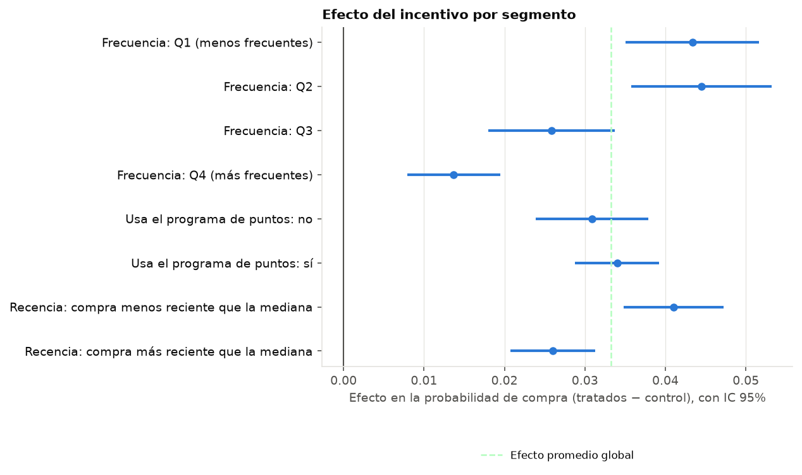

# Etapa 2 — El experimento

## ¿Fue al azar?

- Clientes: 200,039 (50.0% tratados)
- Mayor |SMD|: 0.0086 (dias_desde_primera); variables con |SMD| > 0.1: 0 de 22
- Ruido esperado del SMD por azar con este tamaño de muestra: ≈ 0.0045, así que el umbral usado es max(0.1, 3 × ruido) = 0.1000
- Variables por encima del umbral: 0
- AUC de un clasificador que intenta predecir el tratamiento: 0.499 (≈ 0.5 si fue al azar)

Sin señales de desbalance: compatible con una asignación al azar.

## ¿Hubo efecto?

- Tasa de compra: 0.6365 en tratados, 0.6033 en control
- Efecto promedio: 0.0332, IC 95% [0.0290, 0.0375], p = 5.8e-53
- IC bootstrap: [0.0291, 0.0372]
- Con CUPED: 0.0320, IC 95% [0.0280, 0.0359]
  - Correlación entre el resultado y n_transacciones: ρ = 0.357
  - Reducción de varianza esperada: ρ² = 12.7%; intervalo 6.6% más angosto

## Efecto por segmento (p-valores corregidos por Holm)

| dimension | segmento | clientes | efecto | ic_inf | ic_sup | p_holm |
|---|---|---|---|---|---|---|
| Frecuencia | Q1 (menos frecuentes) | 50010 | 0.0434 | 0.0351 | 0.0517 | 0.0000 |
| Frecuencia | Q2 | 50010 | 0.0444 | 0.0357 | 0.0532 | 0.0000 |
| Frecuencia | Q3 | 50009 | 0.0258 | 0.0180 | 0.0337 | 0.0000 |
| Frecuencia | Q4 (más frecuentes) | 50010 | 0.0137 | 0.0079 | 0.0194 | 0.0000 |
| Usa el programa de puntos | no | 78099 | 0.0309 | 0.0239 | 0.0379 | 0.0000 |
| Usa el programa de puntos | sí | 121940 | 0.0340 | 0.0288 | 0.0392 | 0.0000 |
| Recencia | compra menos reciente que la mediana | 100019 | 0.0410 | 0.0348 | 0.0472 | 0.0000 |
| Recencia | compra más reciente que la mediana | 100020 | 0.0260 | 0.0208 | 0.0313 | 0.0000 |

