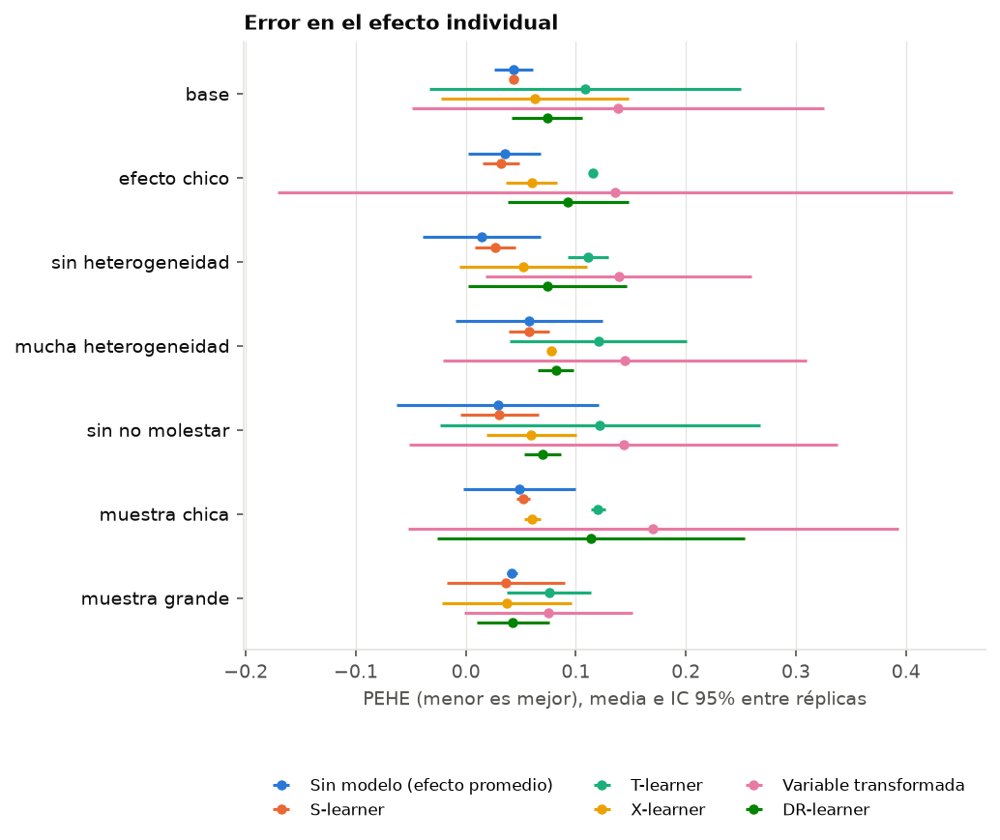
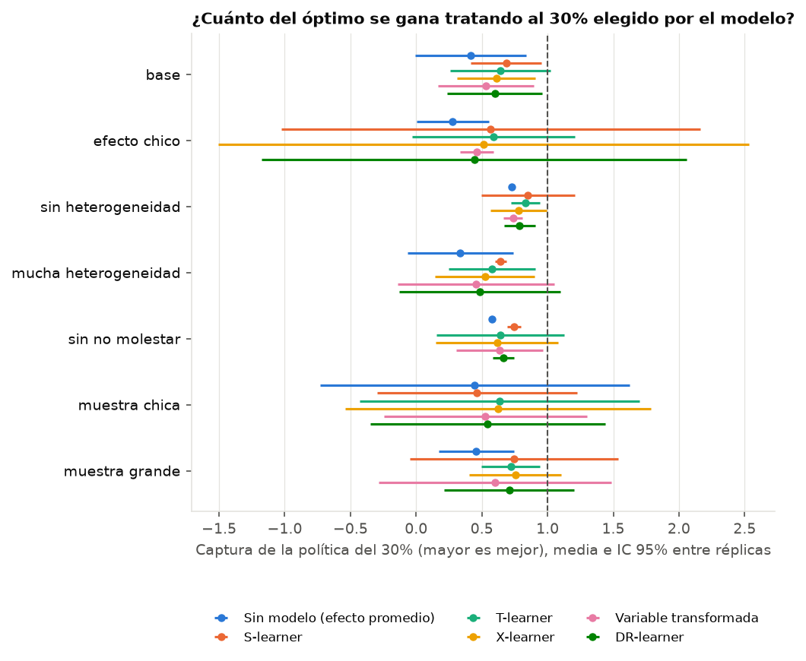
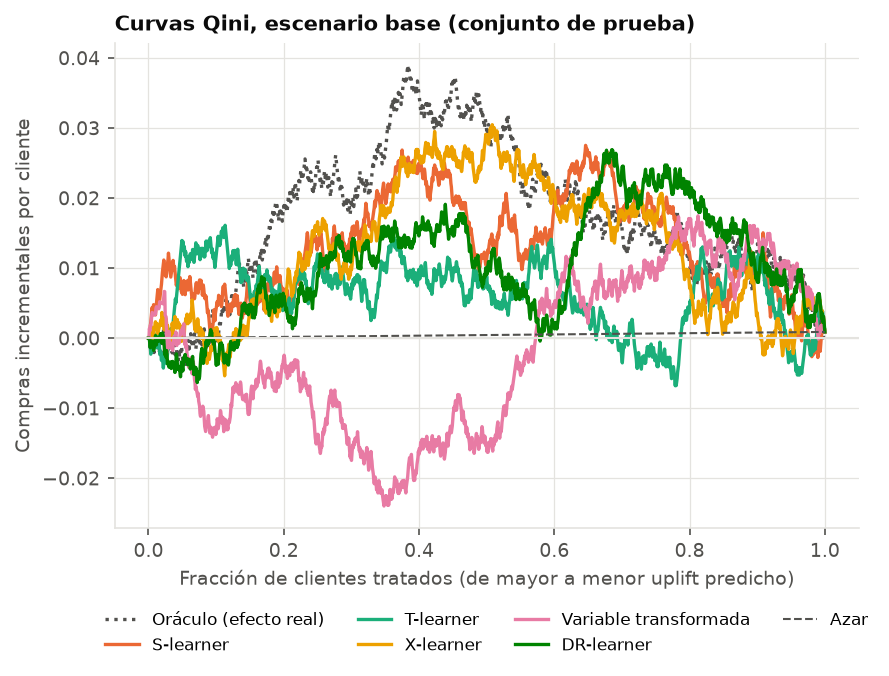

# Etapa 3 — Simulación con efecto conocido

2 réplicas por escenario; cada método se entrena con el 70% y se evalúa en el 30%.
Las variables son las reales de 79,665 clientes; el resultado se genera con un efecto individual conocido.

## Escenarios (se varía un factor por vez respecto del base)

| escenario | clientes | efecto promedio | heterogeneidad | no molestar |
|---|---|---|---|---|
| base | 5,000 | 0.03 | 1.0 | 10% |
| efecto chico | 5,000 | 0.01 | 1.0 | 10% |
| sin heterogeneidad | 5,000 | 0.03 | 0.0 | 0% |
| mucha heterogeneidad | 5,000 | 0.03 | 2.5 | 10% |
| sin no molestar | 5,000 | 0.03 | 1.0 | 0% |
| muestra chica | 2,000 | 0.03 | 1.0 | 10% |
| muestra grande | 20,000 | 0.03 | 1.0 | 10% |

## Escenario base

| metodo | pehe | captura | qini_relativo | sesgo_ate | segundos |
|---|---|---|---|---|---|
| Sin modelo (efecto promedio) | 0.0432 | 0.4174 | 0.2204 | -0.0017 | 0.0000 |
| S-learner | 0.0433 | 0.6863 | 0.3788 | -0.0176 | 0.0821 |
| T-learner | 0.1086 | 0.6406 | 0.4152 | -0.0079 | 0.0828 |
| X-learner | 0.0626 | 0.6093 | 0.7770 | -0.0053 | 0.1515 |
| Variable transformada | 0.1383 | 0.5284 | 0.2085 | 0.0005 | 0.0287 |
| DR-learner | 0.0738 | 0.5976 | 0.2844 | -0.0116 | 0.4409 |

- **PEHE**: error en el efecto de cada cliente. *Sin modelo (efecto promedio)* asigna a todos el mismo efecto: su PEHE es el desvío del efecto real.
- **Captura**: tratando al 30% con mayor uplift predicho, qué fracción se obtiene de lo que ganaría la mejor elección posible. Sin modelo, la elección es al azar.
- **Qini relativo**: coeficiente Qini (calculado con compras observadas, como en datos reales) sobre el del oráculo que ordena por el efecto real. Es mucho más ruidoso que el PEHE y la captura, que usan el efecto real: con pocos clientes de prueba, hasta el ordenamiento al azar puede salir bien. Es la única de las tres métricas disponible en la etapa 4.

## Mejor método por escenario

| escenario | mejor en PEHE | PEHE | PEHE sin modelo | mejor en captura | captura | captura sin modelo |
|---|---|---|---|---|---|---|
| base | S-learner | 0.0433 | 0.0432 | S-learner | 0.6863 | 0.4174 |
| efecto chico | S-learner | 0.0317 | 0.0353 | T-learner | 0.5880 | 0.2766 |
| sin heterogeneidad | S-learner | 0.0267 | 0.0145 | S-learner | 0.8504 | 0.7296 |
| mucha heterogeneidad | S-learner | 0.0575 | 0.0573 | S-learner | 0.6432 | 0.3349 |
| sin no molestar | S-learner | 0.0306 | 0.0290 | S-learner | 0.7476 | 0.5746 |
| muestra chica | S-learner | 0.0520 | 0.0485 | T-learner | 0.6353 | 0.4456 |
| muestra grande | S-learner | 0.0365 | 0.0420 | X-learner | 0.7548 | 0.4577 |

