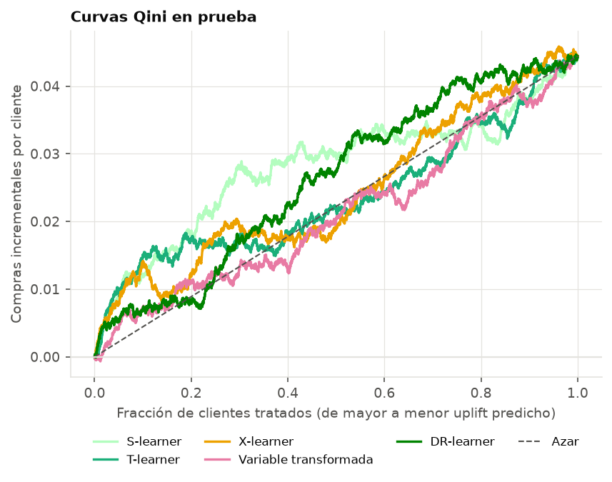
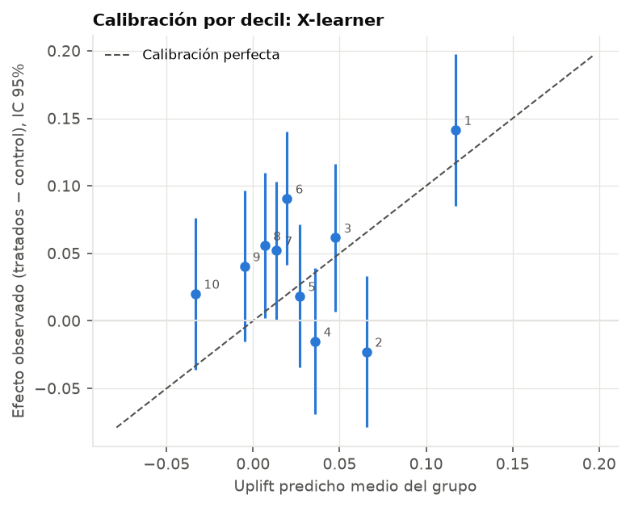

# Etapa 4 — Uplift en el experimento real

- Clientes: 39,854; entrenamiento 27,788, prueba 12,066
- Efecto promedio en prueba: 0.0444 [0.0271, 0.0618]
- Modelo elegido por Qini en validación cruzada (3 pliegues, solo entrenamiento): **X-learner**

## Coeficiente Qini en prueba (IC 95% bootstrap, 500 remuestras pareadas)

| metodo | qini_cv | qini | ic_inf | ic_sup | prob_qini_positivo | dif_vs_elegido_ic_inf | dif_vs_elegido_ic_sup |
|---|---|---|---|---|---|---|---|
| S-learner | 0.00173 | 0.00557 | 0.00049 | 0.01036 | 0.98400 | -0.00148 | 0.00851 |
| T-learner | -0.00073 | 0.00144 | -0.00358 | 0.00630 | 0.69600 | -0.00469 | 0.00331 |
| X-learner | 0.00319 | 0.00225 | -0.00275 | 0.00683 | 0.78600 | 0.00000 | 0.00000 |
| Variable transformada | 0.00202 | -0.00090 | -0.00500 | 0.00439 | 0.33600 | -0.00936 | 0.00321 |
| DR-learner | 0.00283 | 0.00393 | -0.00124 | 0.00902 | 0.93400 | -0.00296 | 0.00680 |

- `qini_cv`: media en validación cruzada (la que decide la elección). `qini`: en prueba.
- `dif_vs_elegido`: intervalo de la diferencia con el modelo elegido sobre las mismas remuestras. Si contiene al 0, la prueba no distingue a ese modelo del elegido.
- El modelo elegido ordena mejor que el azar con probabilidad bootstrap 0.79.

## Calibración por decil (X-learner)

- Decil de mayor uplift predicho: predicho 0.1171, observado 0.1414 [0.0854, 0.1973]
- Decil de menor uplift predicho: predicho -0.0333, observado 0.0201 [-0.0362, 0.0765]
- Pendiente de observado sobre predicho: 0.45 (1 = calibrado; menor que 1 = el modelo exagera las diferencias entre clientes)

| grupo | clientes | uplift_predicho | efecto_observado | ic_inf | ic_sup |
|---|---|---|---|---|---|
| 1 | 1206 | 0.1171 | 0.1414 | 0.0854 | 0.1973 |
| 2 | 1207 | 0.0655 | -0.0228 | -0.0789 | 0.0333 |
| 3 | 1206 | 0.0476 | 0.0617 | 0.0067 | 0.1166 |
| 4 | 1207 | 0.0359 | -0.0152 | -0.0693 | 0.0389 |
| 5 | 1207 | 0.0269 | 0.0184 | -0.0346 | 0.0714 |
| 6 | 1206 | 0.0196 | 0.0907 | 0.0413 | 0.1400 |
| 7 | 1207 | 0.0135 | 0.0521 | 0.0011 | 0.1031 |
| 8 | 1206 | 0.0068 | 0.0559 | 0.0023 | 0.1094 |
| 9 | 1207 | -0.0051 | 0.0404 | -0.0156 | 0.0964 |
| 10 | 1207 | -0.0333 | 0.0201 | -0.0362 | 0.0765 |

