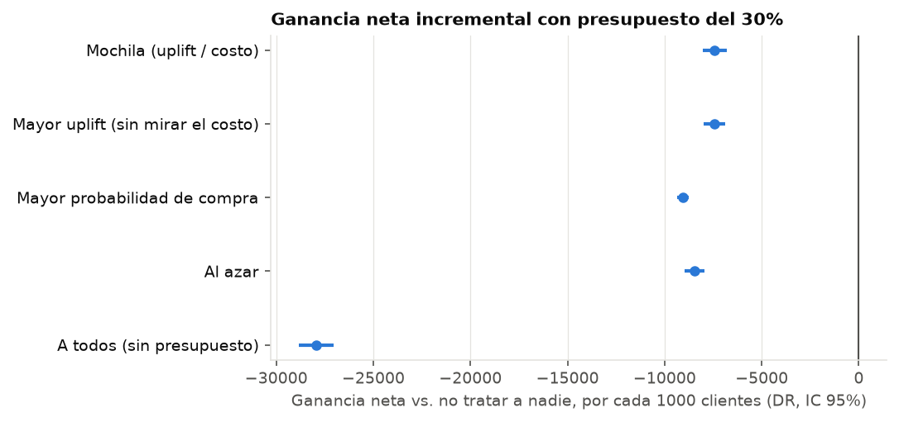
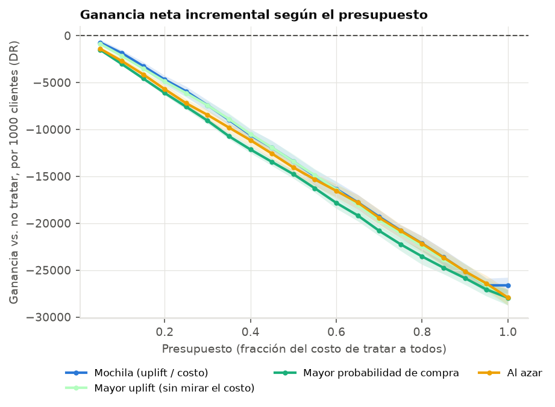
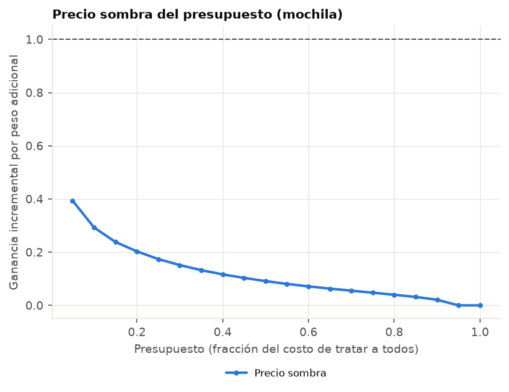

# Etapa 5 — Política con presupuesto

- Clientes de prueba: 60,457. Uplift de **X-learner** (elegido en la etapa 4); probabilidad sin incentivo del modelo de control del T-learner.
- Supuestos: margen 25%, descuento 10% del ticket si el tratado compra, costo por contacto 1. Monto de la compra: ticket medio del cliente.
- Valores en ganancia neta (margen − descuentos − contactos) por cada 1000 clientes, en la moneda de los tickets.

## Presupuesto del 30% del costo de tratar a todos

| politica | tratados | dif_vs_referencia | dif_ic_inf | dif_ic_sup | gasto_esperado | gasto_dr |
|---|---|---|---|---|---|---|
| Mochila (uplift / costo) | 0.38 | -7422.18 | -8039.40 | -6797.08 | 9313.25 | 9317.89 |
| Mayor uplift (sin mirar el costo) | 0.36 | -7440.16 | -7998.98 | -6864.43 | 9313.25 | 9332.43 |
| Mayor probabilidad de compra | 0.24 | -9069.34 | -9343.62 | -8769.58 | 9313.24 | 9268.01 |
| Al azar | 0.30 | -8453.78 | -8961.58 | -7926.79 | 9313.25 | 9224.30 |
| A todos (sin presupuesto) | 1.00 | -27947.78 | -28832.02 | -27043.77 | 31044.18 | 30883.55 |
| A nadie | 0.00 | 0.00 | 0.00 | 0.00 | 0.00 | 0.00 |

- `dif_vs_referencia`: ganancia neta frente a no tratar a nadie, estimador doblemente robusto, IC 95% bootstrap pareado.
- `gasto_esperado`: gasto que predice el modelo (con eso se arma la política); `gasto_dr`: gasto estimado con las compras observadas.
- Precio sombra con este presupuesto: **0.15**: un peso más de presupuesto agrega 0.15 de ganancia incremental (menos de lo que cuesta: conviene achicar el presupuesto).
- Greedy vs. solución entera exacta (milp, 2,000 clientes): el greedy queda a 0.004% del óptimo.
- Errores estándar con la mochila: IPW 530.47, DR 402.23 por 1000 clientes.

## ¿Cuánto presupuesto?

El presupuesto que maximiza la ganancia neta esperada trata mientras el precio sombra sea mayor que 1. Se elige con el modelo, sin mirar las compras de prueba.

- Presupuesto óptimo: 0.2% del costo de tratar a todos (0.4% de los clientes)
- Ganancia neta que predice el modelo: 10.80 por 1000 clientes
- Ganancia neta estimada con las compras observadas (DR): 15.61 por 1000 clientes, IC 95% [-11.03, 44.77]

Si el modelo promete bastante más de lo que se observa, está exagerando el uplift de los clientes que elige (ver la pendiente de calibración de la etapa 4): la mochila elige justo a los clientes con el uplift más sobreestimado. Antes de usar la política conviene recalibrar el uplift o achicar el presupuesto.

## Sensibilidad a los supuestos (presupuesto óptimo en cada caso)

| margen | descuento | tratados | presupuesto_optimo | ganancia_esperada | ganancia_dr | ic_inf | ic_sup |
|---|---|---|---|---|---|---|---|
| 0.150 | 0.050 | 0.006 | 0.002 | 9.744 | 12.096 | -8.166 | 38.579 |
| 0.150 | 0.100 | 0.000 | 0.000 | 0.020 | 0.392 | 0.000 | 1.075 |
| 0.150 | 0.200 | 0.000 | 0.000 | 0.000 | 0.000 | 0.000 | 0.000 |
| 0.250 | 0.050 | 0.036 | 0.021 | 103.461 | 75.772 | -82.326 | 298.324 |
| 0.250 | 0.100 | 0.004 | 0.002 | 10.800 | 15.608 | -10.424 | 45.452 |
| 0.250 | 0.200 | 0.000 | 0.000 | 0.000 | 0.000 | 0.000 | 0.000 |
| 0.350 | 0.050 | 0.091 | 0.059 | 380.974 | 441.223 | -3.256 | 945.805 |
| 0.350 | 0.100 | 0.014 | 0.006 | 53.094 | 19.383 | -112.802 | 137.341 |
| 0.350 | 0.200 | 0.001 | 0.000 | 2.289 | 4.784 | -8.774 | 17.828 |

## Control: composición por género de los tratados

El género no entra al modelo; esto controla que la política no lo discrimine de rebote a través de otras variables.

| genero | poblacion | tratados_mochila | razon |
|---|---|---|---|
| U | 0.464 | 0.488 | 1.052 |
| F | 0.368 | 0.357 | 0.970 |
| M | 0.168 | 0.155 | 0.922 |
