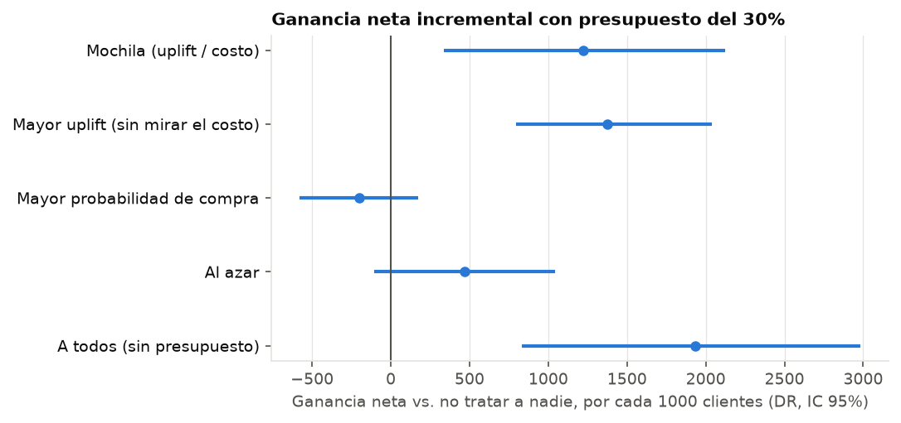
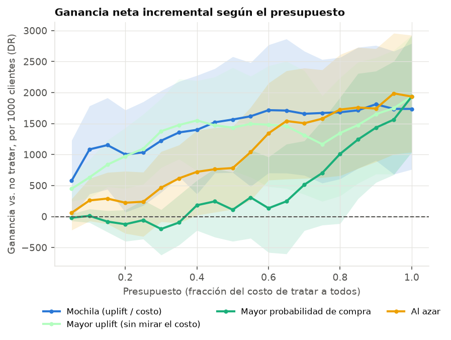
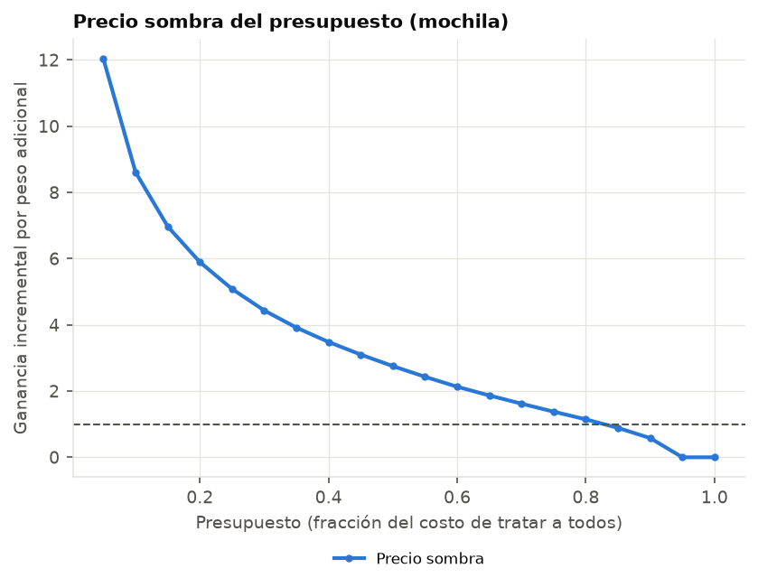

# Etapa 5 — Política con presupuesto

- Clientes de prueba: 60,457. Uplift de **X-learner** (elegido en la etapa 4); probabilidad sin incentivo del modelo de control del T-learner.
- Supuestos: margen 25%, descuento 0% del ticket si el tratado compra, costo por contacto 1. Monto de la compra: ticket medio del cliente.
- Valores en ganancia neta (margen − descuentos − contactos) por cada 1000 clientes, en la moneda de los tickets.

## Presupuesto del 30% del costo de tratar a todos

| politica | tratados | dif_vs_referencia | dif_ic_inf | dif_ic_sup | gasto_esperado | gasto_dr |
|---|---|---|---|---|---|---|
| Mochila (uplift / costo) | 0.30 | 1223.67 | 336.94 | 2125.13 | 300.00 | 300.00 |
| Mayor uplift (sin mirar el costo) | 0.30 | 1376.45 | 792.95 | 2037.82 | 300.00 | 300.00 |
| Mayor probabilidad de compra | 0.30 | -200.69 | -579.44 | 172.32 | 300.00 | 300.00 |
| Al azar | 0.30 | 465.99 | -104.16 | 1042.80 | 300.00 | 300.00 |
| A todos (sin presupuesto) | 1.00 | 1935.77 | 834.58 | 2984.01 | 1000.00 | 1000.00 |
| A nadie | 0.00 | 0.00 | 0.00 | 0.00 | 0.00 | 0.00 |

- `dif_vs_referencia`: ganancia neta frente a no tratar a nadie, estimador doblemente robusto, IC 95% bootstrap pareado.
- `gasto_esperado`: gasto que predice el modelo (con eso se arma la política); `gasto_dr`: gasto estimado con las compras observadas.
- Precio sombra con este presupuesto: **4.44**: un peso más de presupuesto agrega 4.44 de ganancia incremental.
- Greedy vs. solución entera exacta (milp, 2,000 clientes): el greedy queda a 0.000% del óptimo.
- Errores estándar con la mochila: IPW 598.91, DR 461.62 por 1000 clientes.

## ¿Cuánto presupuesto?

El presupuesto que maximiza la ganancia neta esperada trata mientras el precio sombra sea mayor que 1. Se elige con el modelo, sin mirar las compras de prueba.

- Presupuesto óptimo: 82.9% del costo de tratar a todos (82.9% de los clientes)
- Ganancia neta que predice el modelo: 3215.33 por 1000 clientes
- Ganancia neta estimada con las compras observadas (DR): 1715.70 por 1000 clientes, IC 95% [645.07, 2694.31]

Si el modelo promete bastante más de lo que se observa, está exagerando el uplift de los clientes que elige (ver la pendiente de calibración de la etapa 4): la mochila elige justo a los clientes con el uplift más sobreestimado. Antes de usar la política conviene recalibrar el uplift o achicar el presupuesto.

## Sensibilidad a los supuestos (presupuesto óptimo en cada caso)

| margen | descuento | tratados | presupuesto_optimo | ganancia_esperada | ganancia_dr | ic_inf | ic_sup |
|---|---|---|---|---|---|---|---|
| 0.150 | 0.000 | 0.691 | 0.691 | 1625.256 | 715.130 | 77.038 | 1304.400 |
| 0.150 | 0.050 | 0.006 | 0.002 | 9.744 | 12.096 | -8.166 | 38.579 |
| 0.150 | 0.100 | 0.000 | 0.000 | 0.020 | 0.392 | 0.000 | 1.075 |
| 0.150 | 0.200 | 0.000 | 0.000 | 0.000 | 0.000 | 0.000 | 0.000 |
| 0.250 | 0.000 | 0.829 | 0.829 | 3215.331 | 1715.698 | 695.234 | 2799.560 |
| 0.250 | 0.050 | 0.036 | 0.021 | 103.461 | 75.772 | -82.326 | 298.324 |
| 0.250 | 0.100 | 0.004 | 0.002 | 10.800 | 15.608 | -10.424 | 45.452 |
| 0.250 | 0.200 | 0.000 | 0.000 | 0.000 | 0.000 | 0.000 | 0.000 |
| 0.350 | 0.000 | 0.879 | 0.879 | 4843.491 | 2781.518 | 1312.378 | 4225.921 |
| 0.350 | 0.050 | 0.091 | 0.059 | 380.974 | 441.223 | -3.256 | 945.805 |
| 0.350 | 0.100 | 0.014 | 0.006 | 53.094 | 19.383 | -112.802 | 137.341 |
| 0.350 | 0.200 | 0.001 | 0.000 | 2.289 | 4.784 | -8.774 | 17.828 |

## Control: composición por género de los tratados

El género no entra al modelo; esto controla que la política no lo discrimine de rebote a través de otras variables.

| genero | poblacion | tratados_mochila | razon |
|---|---|---|---|
| U | 0.464 | 0.488 | 1.051 |
| F | 0.368 | 0.357 | 0.970 |
| M | 0.168 | 0.155 | 0.924 |
