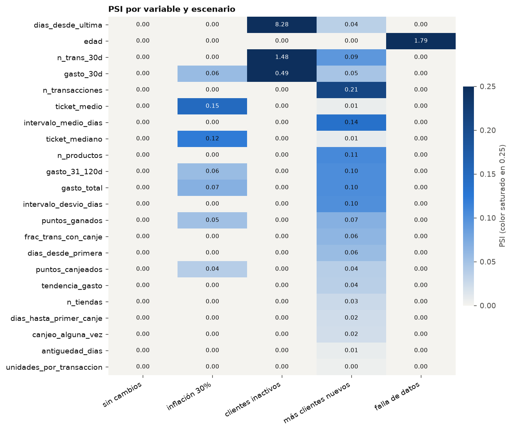

# Etapa 6 — Validación y monitoreo de drift

Referencia: 40,006 clientes; datos "actuales": la otra mitad (39,659), con cambios conocidos.
Umbrales de PSI: > 0.1 revisar, > 0.25 alerta.

## Escenarios

| escenario | errores_validacion | avisos_validacion | detalle_validacion | variables_en_alerta | variables_a_revisar | variable_mas_afectada | psi_max | sliced_wasserstein | psi_prediccion | cambio_tau_medio |
|---|---|---|---|---|---|---|---|---|---|---|
| sin cambios | 0 | 0 | - | 0 | 0 | gasto_30d | 0.001 | 0.012 | 0.001 | 0.001 |
| inflación 30% | 0 | 0 | - | 0 | 2 | ticket_medio | 0.148 | 0.124 | 0.003 | 0.003 |
| clientes inactivos | 0 | 1 | dias_desde_ultima: 100.0% de valores fuera del rango de entrenamiento | 3 | 0 | dias_desde_ultima | 8.283 | 0.978 | 0.142 | -0.010 |
| más clientes nuevos | 0 | 0 | - | 0 | 6 | n_transacciones | 0.210 | 0.145 | 0.003 | 0.001 |
| falla de datos | 1 | 0 | edad: faltantes 40.7% (en entrenamiento 0.8%) | 1 | 0 | edad | 1.789 | 0.020 | 0.047 | -0.012 |

- `errores_validacion`: lo que haría frenar el pipeline antes de puntuar. La validación no distingue una falla de carga de un cambio real de la población (por ejemplo, más clientes nuevos implica más faltantes en las variables que necesitan varias compras): frena y deja la decisión a una persona.
- `psi_prediccion`: PSI de la distribución del uplift predicho. Un cambio en las variables que el modelo casi no usa puede no moverla; uno en las que usa, sí.

## Falsas alarmas: PSI entre dos muestras de la misma población

| clientes_por_muestra | psi_medio | psi_esperado | frac_revisar | frac_alerta |
|---|---|---|---|---|
| 200 | 0.0873 | 0.0900 | 0.3500 | 0.0000 |
| 500 | 0.0337 | 0.0360 | 0.0045 | 0.0000 |
| 2000 | 0.0079 | 0.0090 | 0.0000 | 0.0000 |
| 10000 | 0.0018 | 0.0018 | 0.0000 | 0.0000 |

Con muestras chicas, el PSI supera los umbrales habituales sin que haya ningún cambio: el umbral tiene que tener en cuenta el tamaño de muestra (el PSI esperado sin drift es aproximadamente (bins − 1)(1/n_ref + 1/n_act)).
