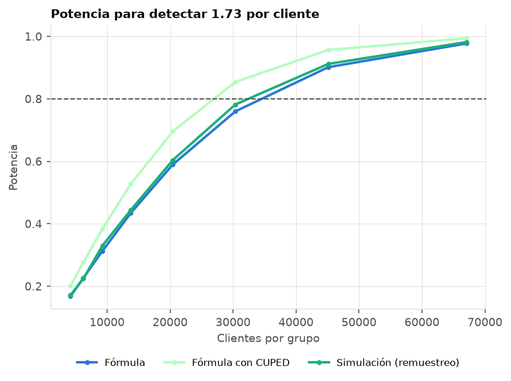

# Etapa 7 — Diseño del A/B de validación

**Pregunta:** ¿la política de la mochila gana más que la práctica actual (*Mayor probabilidad de compra*) con el mismo presupuesto?

## Diseño propuesto

- **Unidad:** cliente, asignado con un hash del `client_id` (estable entre corridas, como el control permanente de la etapa 6). Los clientes del control permanente quedan afuera.
- **Grupos:** A aplica la mochila, B aplica *Mayor probabilidad de compra*, cada uno con un presupuesto proporcional a su tamaño. El control permanente mide, además, el efecto absoluto de cada política.
- **Métrica principal:** ganancia neta por cliente en la ventana de la campaña (margen − descuentos − contactos), con supuestos: margen 25%, descuento 10%, contacto 1.
- **Métricas de control:** gasto total contra presupuesto en cada grupo; tasa de compra; composición por género de los tratados.
- **Análisis:** diferencia de medias con CUPED usando `gasto_total` previo a la campaña; un solo análisis al final del horizonte fijado (sin mirar antes); control de SRM antes de leer el resultado.

## Lo que dicen los datos del experimento

- Ganancia por cliente bajo la mochila: media 62.30, desvío 77.33 (6,075 clientes de prueba compatibles)
- Bajo *Mayor probabilidad de compra*: media 60.28, desvío 82.55 (6,101 clientes)
- Diferencia estimada (DR): **1.73** por cliente, IC 95% [0.27, 3.25]
- Correlación de la métrica con `gasto_total`: ρ ≈ 0.47, así que CUPED reduce la varianza un 22%

## Tamaño de muestra (α = 0.05, potencia 80%)

| efecto_supuesto | delta_por_cliente | clientes_por_grupo | con_cuped | fraccion_poblacion_con_cuped |
|---|---|---|---|---|
| Estimado (DR, etapa 5) | 1.7306 | 33529 | 26226 | 0.6584 |
| Extremo inferior del IC 95% | 0.2682 | 1395644 | 1091654 | 27.4061 |
| Mitad del estimado | 0.8653 | 134114 | 104902 | 2.6336 |

Con el efecto estimado hacen falta 33,529 clientes por grupo sin CUPED. El IC de la diferencia es ancho: planificar con el efecto puntual da un A/B con poca potencia si el efecto real está cerca del extremo inferior. Hay supuestos de efecto para los que no alcanza toda la población (fracción > 1): habría que juntar varias campañas, aceptar menos potencia o un efecto mínimo mayor.

La simulación remuestrea las ganancias observadas (asimétricas y con muchos ceros) y aplica un test t de Welch: si coincide con la fórmula, la aproximación normal es razonable para estos tamaños.

## Por qué no mirar el resultado antes de tiempo (A/A, α = 0.05)

| miradas | falsos_positivos |
|---|---|
| 1 | 0.045 |
| 2 | 0.084 |
| 5 | 0.144 |
| 10 | 0.192 |
| 20 | 0.245 |

Frenar en la primera mirada con p < 0.05 infla la tasa de falsos positivos. Si hace falta mirar antes, usar un método secuencial (por ejemplo, límites de O'Brien-Fleming o un test mSPRT) en lugar del test fijo.

## Sample ratio mismatch en el experimento de X5

Tratados 19,794, control 20,060: p-valor del test chi-cuadrado contra 50/50 = 0.183 (sin evidencia de desbalance en la asignación).
